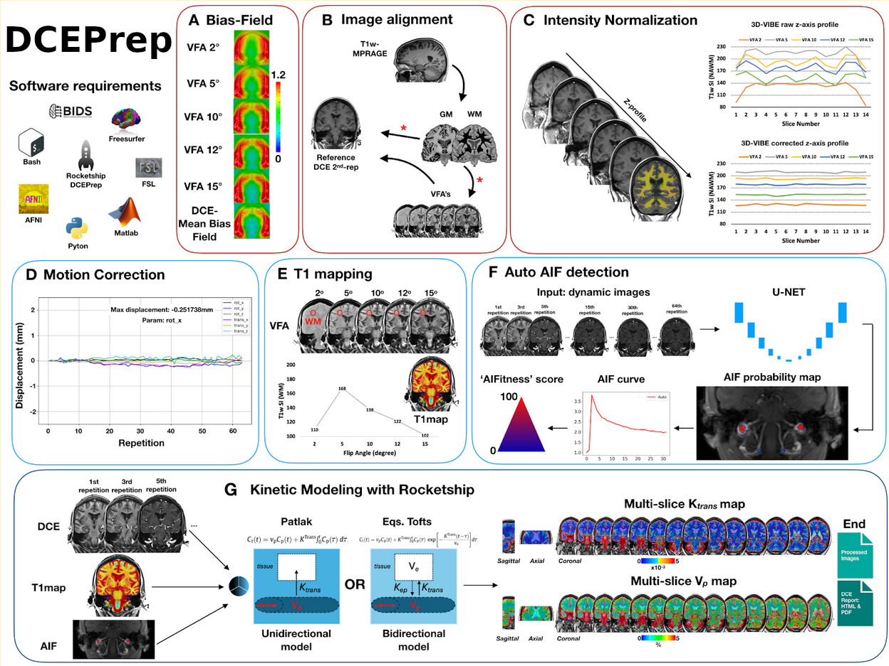

# DCEprep

A preprocessing and analysis pipeline for Dynamic Contrast-Enhanced (DCE) MRI data. Handles VFA-based T1 mapping, bias field correction, z-axis normalization, motion correction, AIF selection, and Ktrans parameter mapping, with automated QC reporting.



#### If you use this software in your research, please cite:

> Barnes S, et al. Automated DCE-MRI processing with DCEPrep for Blood-Brain Barrier permeability in a multi-site aging study. *Pending*. 2026.

---

## Table of Contents

- [Installation](#installation)
  - [Docker (Recommended)](#docker-recommended-easy-consistent-18-gb)
  - [Without Docker](#without-docker)
    - [Dependencies](#dependencies-without-docker)
- [Data Organization](#data-organization)
- [Pipeline Structure](#pipeline-structure)
  - [Preprocessing: preprocess_all.sh](#preprocessing-preprocess_allsh)
  - [Analysis: DCE_all.sh](#analysis-dce_allsh)

---

## Installation

Clone the repository. The `main` branch is stable. Check out a specific tag for a pinned release.

```bash
git clone https://github.com/petmri/DCEPrep.git
```

### Docker (Recommended, easy, consistent, ~18 GB)

The easiest way to get started is with the included `run_docker.sh` script, which will automatically pull the Docker image and launch a container.

> **Important:** Make sure the following are shared (mounted) with the Docker container:
> - MATLAB license file
> - FreeSurfer license file
> - Your data directory
> - Script preference folder (`docker/files/`)
> - `/etc/`
>
> Edit line 24 of `run_docker.sh` to set your data directory before running.

```bash
./run_docker.sh
```

To pull the image manually:

```bash
docker pull lsaca05/dce:<MATLAB_release>-<branch>
# Example:
docker pull lsaca05/dce:R2022a-dev
```

See [Docker Hub tags](https://hub.docker.com/repository/docker/lsaca05/dce/tags) for available releases.

### Without Docker

Setup a Python virtual environment and install dependencies from `venv_requirements.txt`:

```bash
cd DCEPrep
python3 -m venv tf
source tf/bin/activate
pip install -r venv_requirements.txt
```

`conda` is also supported — install packages from `venv_requirements.txt` into your conda environment.

#### Dependencies (Without Docker)
If running without Docker, in addition to the Python packages in `venv_requirements.txt`, the following software must be installed and accessible in your system's PATH:
| Dependency | Version / Notes |
|---|---|
| FSL | 6.0 |
| ANTs | 2.6.2 |
| FreeSurfer | Linux-centos6_x86_64-stable-pub-v6.0.0-2beb96c (wm parcellation) |
| MATLAB | R2023a |
| Python | 3.8.10 or 3.10 |
| ROCKETSHIP + parametric_scripts | 1.2 |

---

## Data Organization

All data is assumed to be [BIDS](https://bids-specification.readthedocs.io/) compliant.

---

## Pipeline Structure

### Preprocessing: `preprocess_all.sh`

#### Inputs

| File | Pattern |
|---|---|
| VFA images (any number of flip angles) | `sub-##_ses-##_flip-##_VFA.nii.gz` |
| DCE image | `sub-##_ses-##_DCE.nii.gz` |
| T1-weighted image | `sub-##_ses-##_T1w.nii.gz` |

#### Main Outputs

| File |
|---|
| `dce/sub-##_ses-##_desc-bfcz_DCE.nii.gz` |
| `anat/sub-##_ses-##_space-DCEref_T1map.nii` |
| `anat/sub-##_ses-##_space-DCEref_VFA.nii.gz` |
| `dce/sub-##_ses-##_label-AIF_T1map.nii.gz` |
| `anat/sub-##_ses-##_space-DCEref_label-brain_mask.nii.gz` |

#### Options

| Flag | Description |
|---|---|
| `-d [rawdata_path]` | **Required.** Path to your BIDS raw data (NIFTIs) folder. |
| `-a [suffix]` | AIF suffix (default: `label-AIF_mask`). `.nii.gz` is appended automatically. |
| `-A [mode]` | Enable AutoAIF: `A` (fully automatic), `M` (manual if available), or `T` (manual + training if available). Requires the [vascular_function repo and weights](https://github.com/petmri/vascular_function). |
| `-b` | Enable first round of bias field correction. |
| `-B` | Enable second round of bias field correction (post-Z-norm, if enabled). |
| `-c` | Clean the case's derivative folder before processing. Ensures fresh runs but disables skips. |
| `-C [name]` | Enable comparison mode. Outputs all files to a named directory within each timepoint. Useful for comparing runs (e.g., no corrections vs. corrections). |
| `-m` | Enable motion correction. |
| `-j [count]` | Limit concurrent VFA registration and FAST jobs within each preprocessing worker. Defaults to unlimited. |
| `-s` | Skip preprocessing if DCE input file already exists. |
| `-t` | Only run up to T1 mapping. |
| `-S [pattern]` | Process only matching subject/session paths relative to the input directory (default: `sub-*/ses-*/`). |
| `-w [path]` | Path to AutoAIF weights file. |
| `-M [model]` | AutoAIF model name. |
| `-p` | Use Python for ROCKETSHIP calls. |
| `-Z` | Enable z-slice normalization. |

FSL `fast` is run through the `FAST_CMD` environment variable (default `fast`). To use the GPU build of FAST from `FSL/fast4`, set e.g. `FAST_CMD="fast_gpu --gpu --gpuraster"` (output byte-identical to FSL `fast`) or `FAST_CMD="fast_gpu --gpu"` (faster, very slightly different). The command used is recorded at the top of each worker log.

The DCE worker writes its large 4D intermediates uncompressed to a local scratch directory (`$DCEPREP_SCRATCH`, default `$TMPDIR` or `/tmp`), about 2 GB per session at most, and gzips only the files it keeps into the session's `dce/` folder, using several threads (`scripts/pgzip.py`; the files are standard multi-member gzip). Point `DCEPREP_SCRATCH` at a local disk with enough free space.

With `-m`, the DCE reference volume (volume 1) is taken from the raw series so T1w/VFA registration can start while motion correction runs; mcflirt registers to that volume, and the worker fails the session if the motion-corrected volume 1 ever differs from it.

With `-p`, `DCE_all.sh` runs ROCKETSHIP with `--no-checkpoints`: its stage checkpoints are debugging files that nothing reads back, about 0.75 GB per session. Set `ROCKETSHIP_CHECKPOINTS=1` to keep writing them to `reports/checkpoints`. Extra arguments for ROCKETSHIP's `run_dce_python_case.py` go in `ROCKETSHIP_DCE_ARGS`, e.g. `ROCKETSHIP_DCE_ARGS="--aif-mode raw"` to fit with the raw AIF curve instead of the fitted one.

The T1w, VFA and scanner T1 map registrations to the DCE smooth in millimetres (`4x3x2x1mm`), so thick-slice images are smoothed the same physical amount in every direction, and they sample every voxel (`None`) rather than a random subset. Until October 2026 they used `4x3x2x1vox` and `Regular,0.25`: on 5 mm RIDER Neuro slices that blurred z by up to 20 mm, and about 40% of VFA registrations slid several slices along z, differently on each run of the same input.

After VFA registration, slices of the registered VFA with fewer than 100 voxels are trimmed from every DCE-space image, but only from the top and bottom of the slab (`fslroi`, which keeps the headers right). An empty slice inside the slab means the VFA registration failed, and the session stops with a message saying so.

**Repeatable runs.** With every voxel sampled the registrations have no random component, but ANTs still splits the metric across threads, and the order the partial results are added in changes from run to run. Usually that moves the transform by a fraction of a millimetre; on thick-slice pairs it can be more (a 0.43×0.43×6 mm T1w to DCE: rotation 2.4–5.2° over 10 repeats). To get identical outputs from identical inputs, run with one ITK thread:

```bash
ITK_GLOBAL_DEFAULT_NUMBER_OF_THREADS=1 ./preprocess_all.sh -d /path/to/bids_data ...
```

Each registration then takes a few seconds instead of under one (1–4 s on the images above), and the other ANTs/ITK steps in the run also use one thread.

#### Example

```bash
./preprocess_all.sh -d /path/to/data/bids_data -b -c -Z -A A -C noMC
```

#### Step Summary

The preprocessing workers overlap independent stages. The list below describes data dependencies rather than a strict wall-clock order: DCE motion correction and AutoAIF can run alongside T1 segmentation and registration; DCE bias correction begins after the DCE-space brain and AIF masks are ready, while T1 mapping and remaining VFA work continue.

1. **Brain Extraction** of T1w MPRAGE using `HD-BET` with default weights (does not brain mask VFAs).
2. <details>
    <summary><b>DCE Motion Correction</b> — FSL <code>mcflirt</code>, targeting 2nd frame with mutual info cost function</summary>
    <code>mcflirt -in $source_dir/dce/${PREFIX}_DCE.nii.gz -refvol 1 -cost mutualinfo -report -plots -o dce/${PREFIX}_desc-hmc_DCE.nii</code>
   </details>
3. <details>
    <summary><b>MPRAGE → DCE Registration</b> — ANTs <code>antsRegistration</code></summary>
    <code>
    antsRegistration --verbose 0 --dimensionality 3 --float 0
        --collapse-output-transforms 1 --output [ anat/${PREFIX}_${REF_SPACE}_T1w,anat/${PREFIX}_${REF_SPACE}_T1w.nii.gz ]
        --interpolation Linear --use-histogram-matching 0 --winsorize-image-intensities [ 0.005,0.995 ]
        --transform Rigid[ 0.1 ] --metric MI[ $DCE_REF_VOL,${source_dir}/anat/${PREFIX}_T1w.nii.gz,1,32,None ]
        --convergence [ 1000x500x250x100,1e-6,10 ] --shrink-factors 12x8x4x2 --smoothing-sigmas 4x3x2x1mm
    </code>
   </details>
4. <details>
    <summary><b>VFA → DCE Registration</b> — ANTs <code>antsRegistration</code></summary>
    <code>
    antsRegistration --verbose 0 --dimensionality 3 --float 0
        --collapse-output-transforms 1 --output [ anat/${PREFIX}_flip-${VFA}_${REF_SPACE},anat/${PREFIX}_flip-${VFA}_${REF_SPACE}_VFA.nii.gz ]
        --interpolation Linear --use-histogram-matching 0 --winsorize-image-intensities [ 0.005,0.995 ]
        --transform Rigid[ 0.1 ] --metric MI[ $DCE_REF_VOL,$source_dir/anat/${PREFIX}_flip-${VFA}_VFA.nii.gz,1,32,None ]
        --convergence [ 1000x500x250x100,1e-6,10 ] --shrink-factors 12x8x4x2 --smoothing-sigmas 4x3x2x1mm
    </code>
   </details>
5. <details>
    <summary><b>MPRAGE White Matter Segmentation</b> — FSL <code>fast</code></summary>
    <code>
    fast -t 1 -n 3 -H 0.1 -I 4 -l 20.0 -b --nopve -g -o anat/${PREFIX}_label- anat/${PREFIX}_label-brain_T1w.nii.gz
    </code>
   </details>
6. **Apply MPRAGE → DCE transform to brain and WM masks** — ANTs `antsApplyTransforms`. The DCE-space brain mask is published as soon as T1 registration is complete.
7. <details>
    <summary><b>VFA Bias Field Correction</b> — FSL <code>fast</code></summary>
    <code>
    fast -t 1 -n 3 -H 0.1 -I 4 -l 20.0 -B --nopve -o anat/${PREFIX}_${VFA}_${REF_SPACE}_label-brain_VFA.nii.gz
    </code>
   </details>
8. **VFA Z-axis Normalization** — double Gaussian fitting (`VFA_norm.py`)
9. **Second VFA Bias Field Correction** — FSL `fast`
10. **T1 Map Generation** — ROCKETSHIP
11. **AIF Drawing via Neural Network** — runs in parallel where enabled; its mask is combined with the DCE-space brain mask.
12. **DCE AIF masking** — create the AIF-included DCE volume once the brain and AIF masks are ready.
13. <details>
    <summary><b>DCE Bias Field Correction</b> — begins once the AIF-included DCE is available and averages bias fields from the 1st + 8 evenly spaced temporal samples via FSL <code>fast</code></summary>
    <code>
    fast -t 1 -n 3 -H 0.1 -I 4 -l 20.0 -b --nopve -o rep_$((rep_interval*i-1)).nii
    </code>
    </details>
14. **AIF T1 Map and DCE Z-axis Normalization** — create the AIF T1 map after T1 mapping completes, then run double-Gaussian DCE normalization (`DCE_norm.py`) using the WM-masked DCE output.

---

### Analysis: `DCE_all.sh`

#### Inputs

| File |
|---|
| `dce/sub-##_ses-##_desc-bfcz_DCE.nii.gz` |
| `anat/sub-##_ses-##_space-DCEref_T1map.nii` |
| `anat/sub-##_ses-##_space-DCEref_VFA.nii.gz` |
| `dce/sub-##_ses-##_label-AIF_T1map.nii.gz` |
| `anat/sub-##_ses-##_space-DCEref_label-brain_mask.nii.gz` |

#### Main Outputs

| File |
|---|
| `sub-##_ses-##_Ktrans.nii` |
| `sub-##_ses-##_vp.nii` |
| `case_report.html` |
| `population_report.html` |

#### Options

| Flag | Description |
|---|---|
| `-d [path]` | **Required.** Path to raw BIDS data directory. Should be something like bids_root/sourcedata/raw |
| `-C [name]` | Enable comparison mode. Copies essential files from a standard run if a preprocessed run of the same name does not exist. |
| `-f` | Enable FreeSurfer WM parcellation for subregion analysis. |
| `-h` | Display help. |
| `-p` | Use Python for ROCKETSHIP calls. |
| `-s` | Skip cases already processed. |
| `-S` | Enable smoothing of DCE input. |
| `-T [dir_path]` | Target specific subject(s)/session(s) (default: `sub-*/ses-*/`). |

#### Example

```bash
./DCE_all.sh -d /path/to/data/bids_data -s -C noMC
```

#### Step Summary

1. **Ktrans Mapping** — ROCKETSHIP
2. **Gray Matter & CSF Masking** — create, align, and apply masks with `antsApplyTransforms` and `fslmaths`
3. **QC Analysis** — run `ktrans_analysis.py` and `ktrans_report.py`
4. **Case Report** — generate `case_report.html` for each case via `case_report.py`
5. **Population Report** — after all cases finish, generate `population_report.html` via `population_report.py`
